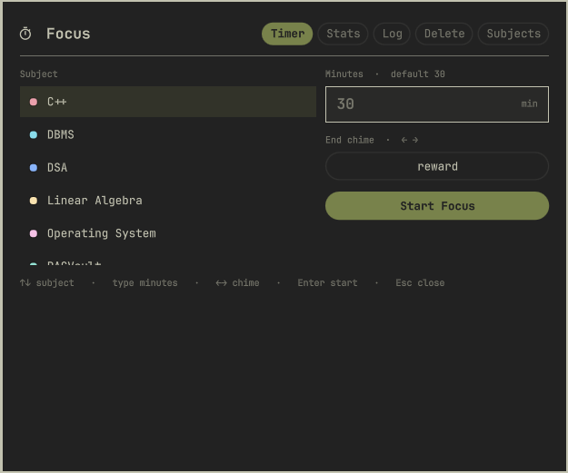
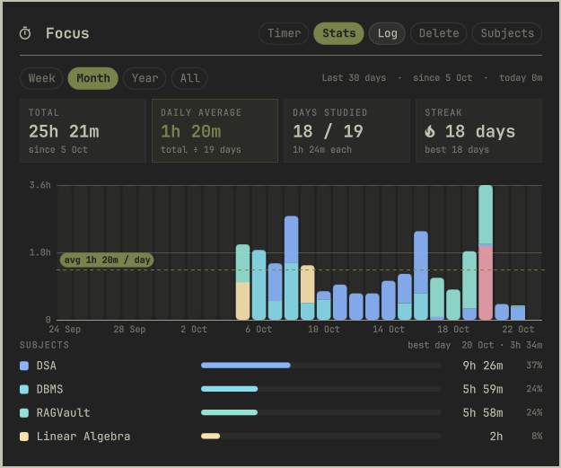

# Focus for Omarchy

A study timer that lives in the Omarchy bar. Pick a subject, start a session,
and keep working — the timer runs in the background and the bar shows a live
countdown. The panel keeps per-subject stats, streaks and a stacked chart of
your study days.

| Timer | Stats |
|---|---|
|  |  |

## What you get

- **Bar button** — a timer icon that turns into a countdown while a session runs.
  Hover it for today's total and your streak; click it to open the panel.
- **Timer** — choose a subject, type the minutes, press Enter. Closing the
  panel or the terminal doesn't stop it; a chime and a notification mark the end.
- **Stats** — totals, daily average, days studied, streak, and a week / month /
  year / all-time chart coloured by subject.
- **Log** — add time you studied away from the computer.
- **Delete** — remove a day's sessions (or one subject's) if you logged by mistake.
- **Subjects** — add, recolour and archive subjects.

The study day rolls over at 04:00, so a late-night session counts toward the
day you started it.

## Install

Focus has two parts: this plugin (the bar button and panel) and
[`omarchy-focus`](https://github.com/luckyhaise/omarchy-focus), the small Go program
that runs the timer and stores your sessions.

1. Install `omarchy-focus`:

   ```bash
   yay -S omarchy-focus-bin
   ```

   or download the binary from the
   [latest release](https://github.com/luckyhaise/omarchy-focus/releases/latest)
   and put it somewhere on your `PATH` (e.g. `~/.local/bin`).

2. Add the plugin and put it in the bar:

   ```bash
   omarchy plugin add https://github.com/luckyhaise/omarchy-focus-plugin --enable
   ```

   It lands on the right side of the bar. Move it with
   `omarchy plugin enable luckydubey.focus --before omarchy.clock` (or any other widget id).

## Keys

| View | Keys |
|---|---|
| Timer | `↑` `↓` subject · type minutes · `←` `→` chime · `Enter` start · `Esc` close |
| Running | `+` add 5 minutes |
| Log | type minutes · `↑` `↓` subject · `←` `→` day · `Enter` add |

You can open the panel from a keybinding too — add this to
`~/.config/hypr/bindings.lua`:

```lua
o.bind("SUPER + ALT + T", "Focus timer", "omarchy-shell shell summon luckydubey.focus '{}'")
```

## Your data

Sessions and subjects are stored locally in `~/.local/share/omarchy-focus/`.
Settings (default minutes, chimes) are in `~/.config/omarchy-focus/config.yml`.
Nothing leaves your machine.

## License

MIT
